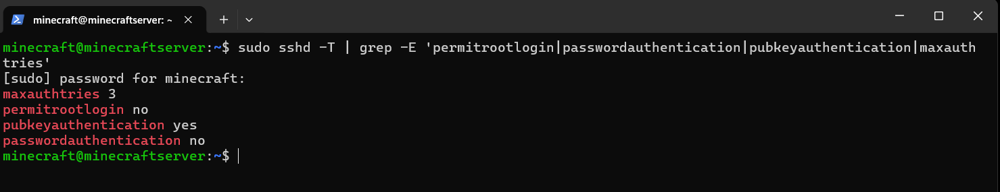
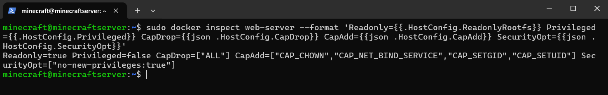
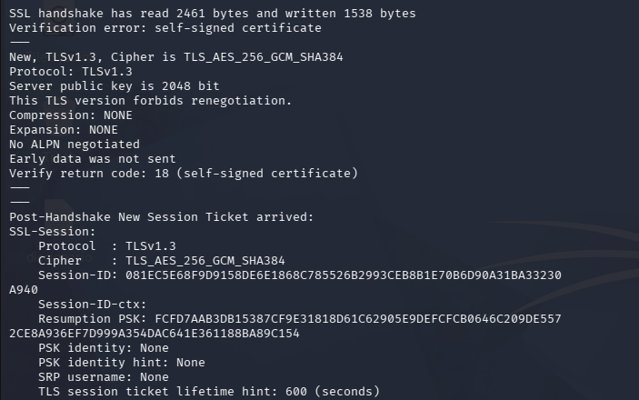
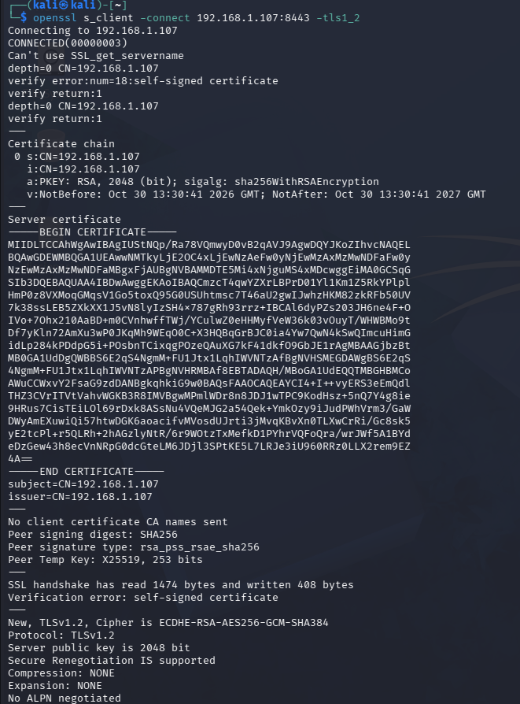
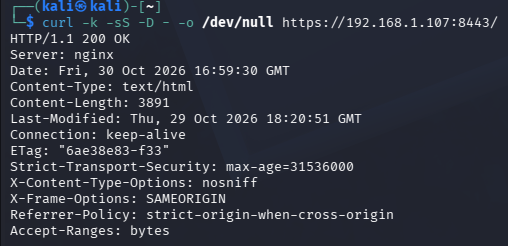
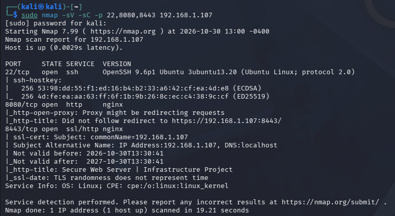
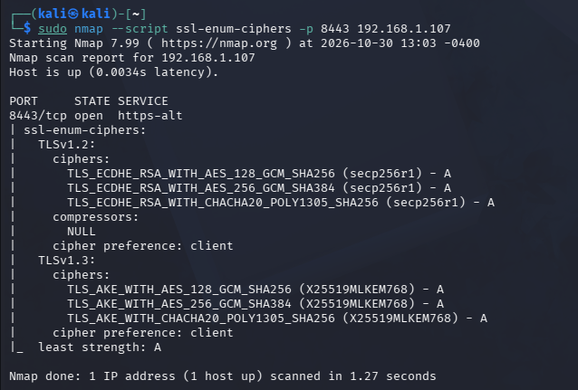

# Secure Web Server Deployment

**A hardened web server infrastructure project using Ubuntu Server, Docker, Nginx, and TLS.**

## Project Overview

This project demonstrates the deployment and security hardening of a web server using Ubuntu Server, Docker, and Nginx.

The objective is to deploy a functional web service while reducing its attack surface, securing remote administration, and protecting HTTP communications through HTTPS.

Security testing is performed from a separate Kali Linux machine to validate the implemented security controls.

## Lab Architecture

The laboratory consists of two physical computers connected through a local network.

| Machine | Role | Environment |
|---|---|---|
| Laptop 1 | Target web server | Ubuntu Server |
| Laptop 2 | Security assessment | Kali Linux running in VirtualBox |

### Network Services

| Host Port | Service | Purpose |
|---|---|---|
| 22 | SSH | Remote administration |
| 8080 | HTTP | Redirects HTTP requests to HTTPS |
| 8443 | HTTPS | Secure web access |

## Technologies

- Ubuntu Server
- Docker Engine
- Nginx
- OpenSSH
- UFW
- OpenSSL
- Nmap
- cURL
- Kali Linux
- VirtualBox

## Security Implementations

### 1. SSH Hardening

Remote administration was secured using SSH public-key authentication.

Implemented controls:

- Root login disabled.
- Password authentication disabled.
- Public-key authentication enabled.
- Maximum authentication attempts limited to three.
- X11 forwarding disabled.

**Configuration validation:**

The effective SSH configuration was inspected using `sshd -T` to verify the applied security settings.



### 2. Docker Container Hardening

The Nginx container was configured following the principle of least privilege.

Implemented controls:

- Read-only container root filesystem.
- Privileged mode disabled.
- All Linux capabilities dropped by default.
- Only required capabilities selectively restored.
- `no-new-privileges` enabled.
- Website files and Nginx configuration mounted read-only.
- Temporary filesystems configured for runtime directories.

**Validation:**

Docker inspection confirmed the read-only filesystem, disabled privileged mode, dropped capabilities, and security options.



### 3. HTTPS and TLS Configuration

HTTPS was configured using Nginx and a self-signed RSA 2048-bit certificate.

Implemented controls:

- TLS 1.2 and TLS 1.3 enabled.
- TLS 1.2 cipher suites restricted to ECDHE with AES-GCM or ChaCha20-Poly1305.
- HTTP requests redirected to HTTPS.
- Certificate includes an IP Subject Alternative Name for the laboratory server.

**TLS 1.3 validation:**

OpenSSL confirmed successful TLS 1.3 negotiation.



**TLS 1.2 validation:**

TLS 1.2 was also tested independently using OpenSSL.



### 4. HTTP Security Headers

The Nginx configuration implements the following response headers:

| Header | Purpose |
|---|---|
| Strict-Transport-Security | Requests HTTPS connections |
| X-Content-Type-Options | Prevents MIME-type sniffing |
| X-Frame-Options | Restricts framing of the website |
| Referrer-Policy | Controls referrer information |

The headers were validated by inspecting the HTTPS response with cURL.



## Network Security Assessment

Security testing was performed from Kali Linux against the Ubuntu Server using Nmap, OpenSSL, and cURL.

### 1. Service Detection

A targeted Nmap scan was performed against ports 22, 8080, and 8443.

Command:

```bash
sudo nmap -sV -sC -p 22,8080,8443 192.168.1.107
```

Identified services:

- SSH: OpenSSH 9.6p1.
- HTTP: Nginx.
- HTTPS: Nginx over TLS.



### 2. TLS Cipher Enumeration

Nmap's `ssl-enum-ciphers` script was used to evaluate the supported TLS cipher suites.

Command:

```bash
sudo nmap --script ssl-enum-ciphers -p 8443 192.168.1.107
```

Observed results:

- TLS 1.2 and TLS 1.3 supported.
- ECDHE-based TLS 1.2 cipher suites detected.
- AES-GCM and ChaCha20-Poly1305 cipher suites detected.
- No CBC or static RSA cipher suites reported.
- Nmap assigned an A grade to the listed cipher suites.



*Note: Nmap cipher grades are scanner assessments and do not constitute a complete security certification.*

### 3. HTTP Response Validation

cURL was used to inspect HTTPS response headers and confirm the security headers were present.

The HTTPS endpoint returned HTTP 200 OK during testing.

## Known Limitations

- The TLS certificate is self-signed and intended for laboratory use. It is not trusted by default by external clients.
- Nginx still identifies itself through the HTTP `Server` header, although its version is hidden.
- The environment is a local laboratory and has not undergone a production security audit.
- Docker-published ports can interact with firewall rules independently of standard UFW filtering. Additional firewall controls may be required.
- HSTS was configured for demonstration purposes; production deployment requires a trusted certificate and an appropriate domain.
- The Nmap `http-open-proxy` script reported an observation on the HTTP redirect endpoint. This was not independently confirmed as an exploitable open proxy.

## Project Structure

```text
secure-web-server/
├── .gitignore
├── README.md
├── nginx/
│   └── default.conf
├── site/
│   └── index.html
├── docs/
└── screenshots/
    ├── docker/
    ├── http/
    ├── nmap/
    ├── ssh/
    ├── tls/
    └── architecture/
```

## Learning Outcomes

This project provided practical experience in:

- Linux server administration.
- Docker deployment and container hardening.
- SSH security configuration.
- HTTPS and TLS configuration.
- HTTP security headers.
- Network reconnaissance and service enumeration.
- Security control validation.
- Infrastructure troubleshooting.
- Technical documentation and evidence collection.

## Project Status

**Core deployment and security
